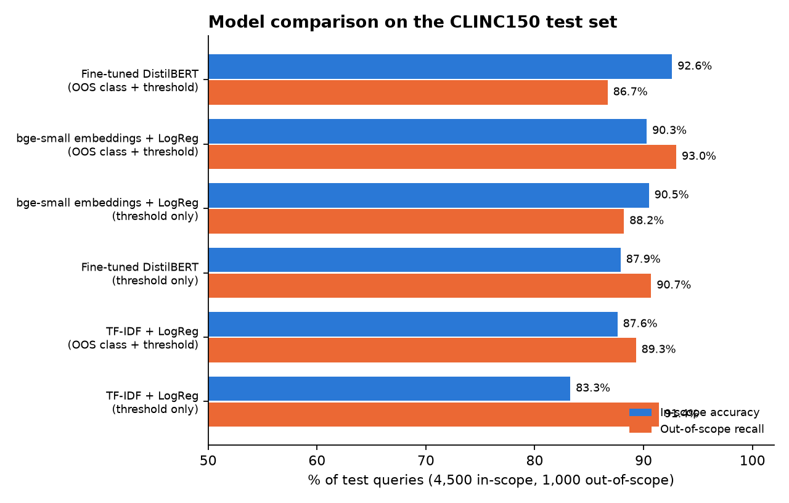
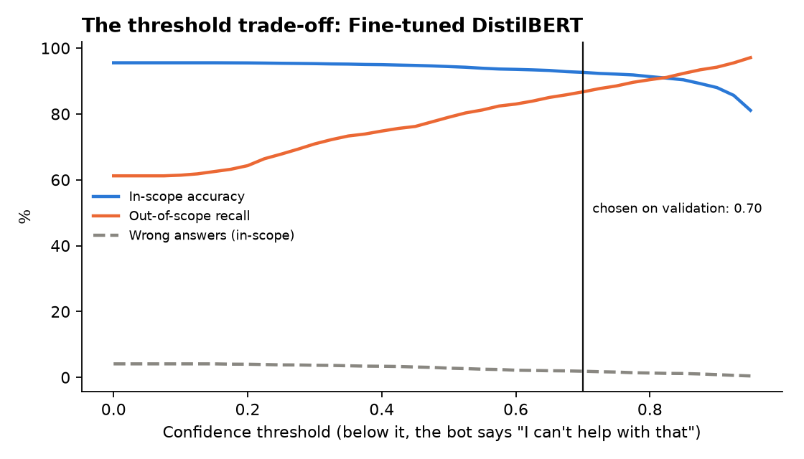

# Chatbot Intent Detection with Out-of-Scope Handling

A customer-service chatbot must do two things: understand what the user wants (150 intents such as `transfer`, `book_flight`, `pto_request`), and **recognise when a question is outside what it was built for** ("who won the cricket match?") so it can hand over to a human instead of giving a wrong answer.

This project compares three NLP approaches, from a classic TF-IDF baseline to a fine-tuned transformer, on both jobs.

   



## Data

[CLINC150](https://huggingface.co/datasets/clinc/clinc_oos) ("plus" version): 23,700 user queries across 150 intents in 10 domains (banking, credit cards, travel, kitchen, work, small talk, ...) plus out-of-scope queries.
Test set: 4,500 in-scope queries and 1,000 out-of-scope queries.

## Results (test set)

| Model | OOS strategy | In-scope accuracy | Out-of-scope recall | Overall accuracy | Wrong answers* | Training time |
|---|---|---|---|---|---|---|
| TF-IDF + LogReg | threshold | 83.3% | 91.4% | 84.8% | 1.8% | 27 s |
| TF-IDF + LogReg | OOS class + threshold | 87.6% | 89.3% | 87.9% | 3.2% | 24 s |
| bge-small embeddings + LogReg | threshold | 90.5% | 88.2% | 90.1% | 1.2% | 19 s |
| bge-small embeddings + LogReg | OOS class + threshold | 90.3% | **93.0%** | 90.8% | 1.1% | 19 s |
| Fine-tuned DistilBERT | threshold | 87.9% | 90.7% | 88.4% | **0.7%** | 6.6 min |
| **Fine-tuned DistilBERT** | OOS class + threshold | **92.6%** | 86.7% | **91.6%** | 1.9% | 6.9 min |

\* *Wrong answers* = in-scope questions answered with the wrong intent. This is the most harmful error for users; sending a question to a human is safer.

**Key findings**

1. **Without out-of-scope handling, models fail silently.** All models reach 92-96% accuracy on in-scope questions. But a model trained only on the 150 intents answers **100% of out-of-scope questions with some wrong intent**, and even with an out-of-scope class it still misses 39-48% of them. In-scope accuracy alone is a misleading metric for a chatbot.
2. **A confidence threshold fixes most of it.** Tuned on the validation set (never on test), it catches 87-93% of out-of-scope queries. The cost: some real questions with low confidence are handed to a human.
3. **Fine-tuned DistilBERT is the most accurate overall (91.6%)**, but **frozen sentence embeddings + logistic regression come within 0.8 points, catch more out-of-scope queries (93.0%) and train 22x faster.** For a first production version, the embedding model is the practical choice; DistilBERT is worth it when the last point of accuracy matters.
4. **Adding 250 labelled out-of-scope examples as a 151st class raises overall accuracy for every model** (+0.7 to +3.2 points), a cheap data investment.

## The threshold trade-off

Raising the threshold sends more questions to a human: out-of-scope recall goes up, in-scope accuracy goes down. The threshold is a business decision (cost of a wrong answer vs cost of a human hand-over); the chart makes it visible:



## Error analysis (best model, DistilBERT + OOS class)

465 errors out of 5,500 test queries:

| Error type | Count | Impact |
|---|---|---|
| In-scope question sent to a human | 248 | safe, costs agent time |
| Out-of-scope question answered as an intent | 133 | user gets an irrelevant answer |
| Wrong intent chosen | 84 | user gets a wrong answer |

63% of intent confusions stay inside the same domain and are close in meaning: `redeem_rewards` → `rewards_balance`, `transactions` → `spending_history`, `pay_bill` → `bill_due`, `pto_request` → `pto_request_status`. Some of these could be merged or handled with a clarifying question ("Do you want to redeem or check your rewards?"). Details: [`reports/error_analysis.json`](reports/error_analysis.json).

## Try it

```bash
python predict.py "what's my checking balance" "book a table for two at 8pm" "who won the cricket match"
```

Prints the intent and confidence for each message, or `out_of_scope -> hand over to a human agent`.

## How to run

```bash
python -m venv .venv && source .venv/bin/activate
pip install -r requirements.txt
python -m src.evaluate   # downloads CLINC150, trains 3 models x 2 strategies (~15 min on Apple M2)
python -m src.report     # comparison table, figures, error analysis
pytest -q                # 3 tests
```

## Method

- **TF-IDF + LogReg:** word 1-2-grams plus character 2-5-grams (robust to typos), logistic regression.
- **Embeddings + LogReg:** sentences encoded once with the frozen `BAAI/bge-small-en-v1.5` model; only a logistic regression is trained on top.
- **DistilBERT:** all layers fine-tuned for 4 epochs (AdamW, linear warm-up and decay, max length 32 tokens).
- **Out-of-scope rule:** if the top probability is below the threshold, or the predicted class is "oos", the bot hands over. The threshold maximises the average of in-scope accuracy and out-of-scope recall on the validation set.

## Project structure

```
├── src/data.py       # load CLINC150, intent -> domain map
├── src/models.py     # TF-IDF, embedding and DistilBERT classifiers (same interface)
├── src/oos.py        # out-of-scope decision rule, metrics, threshold tuning
├── src/evaluate.py   # trains and tests every model x strategy
├── src/report.py     # comparison table, figures, error analysis
├── predict.py        # classify new messages
├── tests/            # unit tests for the OOS logic and metrics
└── reports/          # results.csv, per-run JSON, predictions, figures
```
